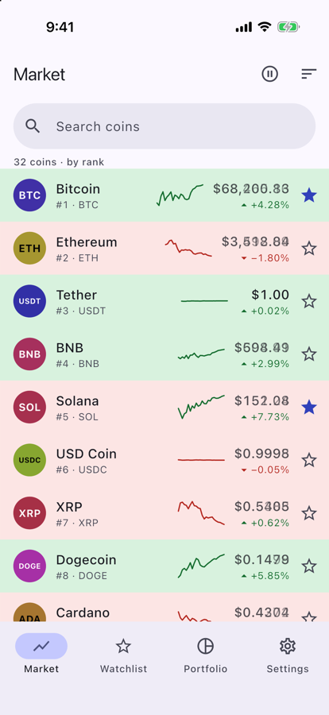
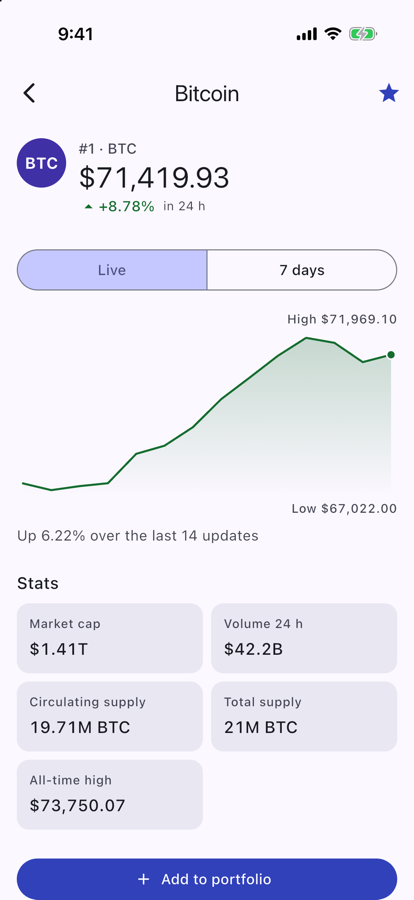
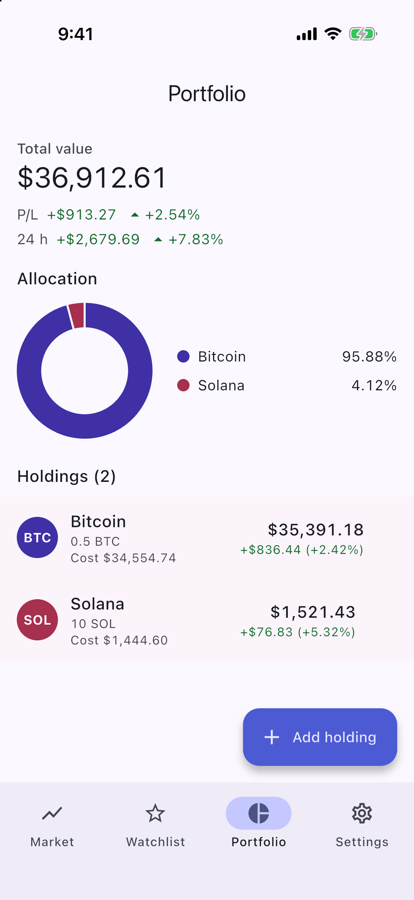
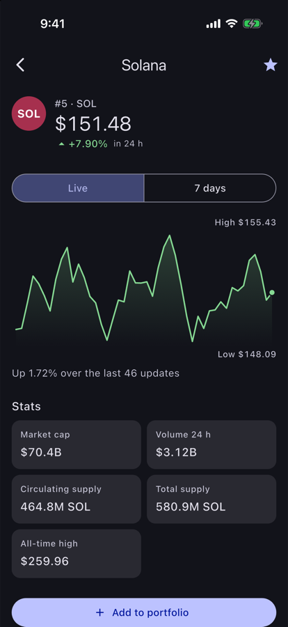

# 📈 CryptoTracker (Flutter)

[](https://github.com/MuhammadFaheemAkram/CryptoTracker-Flutter/actions/workflows/flutter-ci.yml)


A live crypto market tracker, and the portfolio's **Dart Streams showcase**.

Prices move on a simulated ticker, and every screen is a **stream pipeline** over it:
- a market list derived from five inputs (`combineLatest`);
- a debounced search that clears at once (`switchMap`);
- green and red flashes from comparing each price with the last (`scan`);
- a bounded price history and a running high for the charts (`scan`);
- a coin's page from six inputs, a watchlist and a portfolio from three, each re-deriving on every tick, every database change and every setting.

It's the Flutter counterpart of the Android edition's **Kotlin Flow** showcase and the iOS edition's **Combine** showcase.

> **Prices are simulated.** They start from a bundled snapshot of 32 coins and move by a random walk on your device. Nothing here is real market data or financial advice.

---

## 🔁 The one rule

```
One PriceTicker owns the live quotes: a stream that always has a current value.
Every price on every screen is DERIVED from it, by a stream pipeline:

  PriceTicker ─ scan (quotes + directions) ─┬─ combineLatest5(query, sort, settings, stars)  ─▶ Market
  (BehaviorSubject)                         ├─ combineLatest3(stars, settings)               ─▶ Watchlist
                                            ├─ combineLatest6(history, high, star, range…)   ─▶ a coin's page
                                            └─ combineLatest3(holdings, settings)            ─▶ Portfolio
              └─ scan ─▶ PriceHistory (the last 60 points, the highest price)

No screen keeps its own copy of a price, and no list is patched by hand.
A star, a saved holding or a setting is a WRITE; every screen READS it back
through its own pipeline (drift queries and the settings are streams too).
```

---

## ⏱️ How the simulated ticker works

- **It starts from the seed:** 32 coins with real-looking prices, loaded once at launch.
- **Each tick:**
  - every price takes one step of a random walk: up to ±1.5 % (±0.05 % for stablecoins), pulled 2 % back towards where it started, so a long session stays plausible;
  - a tick comes every 2 seconds by default (1, 2 or 5 in Settings).
- **The 24 h change is derived, never accumulated:**
  - each quote keeps the price 24 h ago from the seed;
  - the change is always `(price / open − 1) × 100`, however many ticks there have been (both native specs add each tick's movement to it, which drifts).
- **It stops when nobody can see it:**
  - in the background (`AppLifecycleListener`), and when the user pauses it (the Market's Pause button or Settings → Live prices: moving content must be pausable, WCAG 2.2.2);
  - it carries on from the same prices when it resumes.
- **It's a `BehaviorSubject`:** a screen opened mid-session gets the current prices at once, then every tick.

The details, with diagrams: [STREAM_PIPELINES.md](docs/STREAM_PIPELINES.md).

---

## 📋 Project Status

**Complete.** Built in **strict, reviewable phases**. Each phase ended with:
- a building app (Android and iOS);
- a clean analyzer and passing tests;
- a mutation pass;
- a summary doc in [`docs/`](docs/);
- exactly one commit.

| Phase | Scope | Status |
|------:|-------|:------:|
| 1 | Foundation: the project, the design system (market colors, `CoinBadge`, `CoinRow`), typed routes and the 4-tab shell, CI | ✅ Done |
| 2 | Models, the bundled seed and a static Market (sort, search, sparklines) | ✅ Done |
| 3 | **Live prices with Dart streams:** the `PriceTicker`, the five-input pipeline, debounce, `scan` flashes, the price history, Pause | ✅ Done |
| 4 | **Watchlist (drift v1) and Coin Detail:** stars on every screen from one table, remove with Undo, a hand-drawn live chart, live stats | ✅ Done |
| 5 | **Portfolio with live valuation:** drift v2 with a tested migration, the allocation donut, the holding form (validated, currency-aware, discard check) | ✅ Done |
| 6 | **Settings** (currency, interval, live prices, appearance, About), applied from the first frame; the documentation set; a release-build launch | ✅ Done |

---

## ✨ Features

- 📈 **Market:** 32 coins ticking every 1, 2 or 5 seconds (or paused); rows flash green or red; 24 h change with ▲/▼; 7-day sparklines; debounced search; sort by rank, price, change or name.
- ⭐ **Watchlist:** star a coin on the Market or its page; the starred coins, in the order you starred them, stored on the device and updating live; remove with a swipe or the star, with Undo.
- 🪙 **Coin Detail:** live price and 24 h change, flashing on each tick; market cap (supply × live price), volume, supply, all-time high (raised when a price beats it); a price chart of the live ticks or the last 7 days, with its trend in words.
- 💼 **Portfolio:** holdings valued live (value, cost, P/L in money and %), the total and its 24 h change, an allocation donut (top 5 + Other, exactly 100 %); add from the tab or a coin's page, edit, remove with Undo.
- 🧾 **Holding form:** a searchable coin picker, the buy price in your currency (suggested from the price now), validation as you type, a live "worth now" preview, and a question before discarding changes.
- ⚙️ **Settings:** USD / EUR / GBP / JPY (converted everywhere, not just relabelled), live prices on or off, the update interval, System / Light / Dark, and About; all applied from the first frame.
- ♿ **Accessible:** color is never the only signal (arrows and signs), ticking prices don't flood screen readers, charts have text summaries, swipes have screen reader actions, reduced motion stops the flashes, large text and dark mode on every screen.

---

## 🧰 Tech Stack

| Area | Choice | Why | Since |
|------|--------|-----|:-----:|
| Toolchain | Flutter 3.47.6 · Dart 3.13, pinned with [FVM](https://fvm.app) (`.fvmrc`) | Reproducible builds | 1 |
| Platforms | Android · iOS | | 1 |
| UI | [`material_ui`](https://pub.dev/packages/material_ui) | Material 3 as a standalone package | 1 |
| Navigation | `go_router` + `go_router_builder` | Typed routes; each tab keeps its state (`StatefulShellRoute`) | 1 |
| DI | `get_it` + `injectable` | Constructor injection, generated wiring (the Hilt equivalent) | 1 |
| Codegen | `build_runner` | Routes and DI are generated; generated files are committed | 1 |
| State | `flutter_bloc` (Cubits) | Each Cubit subscribes to its pipeline and emits immutable states | 2 |
| Models | `freezed` + `json_serializable` | Immutable models with value equality; checked DTOs | 2 |
| Formatting | `intl` | Prices in each currency, significant digits under one unit, compact amounts | 2 |
| Time | `clock` | An injectable "now" (fixed in tests) | 2 |
| **Streams** | **Dart `Stream` + `rxdart`** | `BehaviorSubject`, `combineLatest5`, `scan`, `switchMap`, `distinct` (see [STREAM_PIPELINES.md](docs/STREAM_PIPELINES.md)) | 3 |
| Preferences | `shared_preferences` (`SharedPreferencesWithCache`) | The settings, read before the first frame | 3 |
| Database | `drift` + `drift_flutter` | The watchlist (v1) and holdings (v2), observed as query streams; schemas exported, the migration tested with data | 4–5 |
| Charts | `CustomPainter` | Hand-drawn sparkline, line chart and donut | 2–5 |
| App info | `package_info_plus` | The version in Settings → About | 6 |

Tests use `flutter_test`, `bloc_test`, `mocktail`, `fake_async`, `async`'s `StreamQueue` (the Turbine of Dart) and drift in memory.

---

## 🏛️ Architecture

Clean layers, with the streams below the widgets:

```
Widget (BlocBuilder)              renders state, calls intents
   ▲  state                 │ intents (search, sort, star, save, a setting)
Cubit                       owns its inputs (seeded subjects) and ONE subscription
   ▲  Stream<…>             │
Use case                    builds the pipeline: combineLatest, scan, switchMap, distinct
   ▲                        │
Repository ── PriceTicker (BehaviorSubject: the live quotes) · PriceHistory
           ── fake API (the seed, once) · drift (watchlist, holdings) · preferences
```

- **Pure functions** do the work inside the pipelines (`buildMarketRows`, `valuePortfolio`, `allocate`, …), so they're tested without streams.
- **Cubits** never compute a row or keep a price; they cancel their subscription in `close()` (and a seed landing mid-close never subscribes).
- **`SettingsCubit`** sits above the router: it starts from the stored settings, so the first frame has the theme.

The whole map: [ARCHITECTURE.md](docs/ARCHITECTURE.md). What flows through it: [DATA_MODEL.md](docs/DATA_MODEL.md).

---

## 🗂️ Folder Structure

```
lib/
├── main.dart                     # await configureDependencies() (preferences open), runApp
├── app/                          # CryptoTrackerApp (SettingsCubit, MaterialApp.router, themes), LiveTicker (lifecycle)
├── core/
│   ├── common/                   # Result, AppException, guardWrite
│   ├── database/                 # AppDatabase (drift, v2 + steps), tables/ (watch_items, holdings), daos/
│   ├── design_system/            # AppTheme, AppColors, tokens, widgets/ (CoinRow, PositionTile, WatchStar, CurrencyPicker, …), charts/ (Sparkline, PriceLineChart, AllocationDonut)
│   ├── formatting/               # MoneyFormatter, PercentFormatter, ChartFormatter (pure Dart)
│   ├── navigation/               # typed routes, the router, the Close fallback
│   ├── network/                  # MarketApi, FakeMarketApi, AssetJsonLoader, dto/
│   ├── prices/                   # PriceTicker, RandomWalk, PriceHistory (points and highs), TickerScheduler (the engine)
│   └── storage/                  # SettingsLocalDataSource (SharedPreferencesWithCache)
├── data/                         # mappers (checked), MarketRepositoryImpl (load once, seeds the ticker), settings, watchlist, portfolio
├── domain/                       # models, pipeline/ (pure pieces: rows, valuation), validation/ (typed numbers), contracts, use cases
├── di/                           # injection.dart, AppModule
└── features/
    ├── shell/                    # the 4-tab NavigationBar
    ├── market/                   # MarketCubit, MarketState, MarketPage, MarketView
    ├── watchlist/                # WatchlistCubit, the starred coins, remove with Undo
    ├── coin_detail/              # CoinDetailCubit (@factoryParam coinId), the live page and chart
    ├── portfolio/                # PortfolioCubit, the totals, the donut, the holdings
    ├── holding_form/             # HoldingFormCubit (two factory params), the form, the coin picker
    └── settings/                 # SettingsCubit (app-wide), the Settings tab
assets/json/                      # coins_seed.json (the iOS edition's), exchange_rates.json
drift_schemas/                    # the exported database schema, one file per version
test/                             # mirrors lib/; helpers/ (fixtures, fakes, the app harness, an in-memory database)
test/drift/                       # the schema checks (generated helpers + tests)
```

---

## ▶️ Running

```bash
fvm install                                  # Flutter 3.47.6, from .fvmrc
fvm flutter pub get
fvm dart run build_runner build              # routes, DI, models and the database are generated
fvm flutter run
```

Checks, as CI runs them:

```bash
fvm dart format --output=none --set-exit-if-changed .
fvm flutter analyze
fvm flutter test
```

A release build: `fvm flutter build apk --release` (Android) or `fvm flutter build ios --release` (iOS, needs signing).

---

## 🌐 The fake market service and the data

- **No backend:**
  - `FakeMarketApi` answers from bundled JSON after 600 ms per request;
  - the repository asks for the coins and the rates at once, so the first screen waits about that long;
  - a real HTTP client could replace it behind `MarketApi` without changing a caller.
- **The seed** is the iOS edition's `coins_seed.json`:
  - 32 coins, with prices sent **as strings**, as many market APIs do;
  - a 24-point 7-day sparkline and the all-time high;
  - plus `is_stablecoin` for USDT, USDC and DAI.
- **`exchange_rates.json`** holds fixed demo rates per dollar.
- **Checked on the way in:**
  - every value is parsed and validated by the mappers (a positive price, a change above −100 %, a rate for every currency);
  - one damaged record fails the load, and the Market offers "Try again".
- **Loaded once:**
  - the repository keeps the first success, shares a load already in flight, and tries again after a failure;
  - from Phase 3 the prices move on the ticker, not by reloading.
- **The watchlist and the holdings are stored on the device** (drift, SQLite). Prices are not: the market starts again from the seed at every launch, as the fake server would.
- **Money is US dollars** everywhere below the UI. A currency is applied only when a value is formatted, and when a buy price is typed.
- **Nothing leaves the device:** there is no network code, and the release build asks for no network permission.

---

## 🧪 Testing

**636 tests**, all on the host, in about 20 seconds:
- **pure functions** for every rule (rows, directions, the history, the valuation, an allocation that adds up to 100.00 %, typed numbers, every formatter);
- **streams** with `StreamQueue` (each input of each pipeline changes, and the next value is checked) and `fakeAsync` (the ticker, the debounce, the scheduler; the 24 h change still exact after 500 ticks);
- **drift in memory** (the DAOs, the `CHECK`s, Undo with the same id) and the v1 → v2 **migration with data**;
- **Cubits** on the real use cases, each closed while loading; **views** with `MockCubit` in every state;
- **flows on the real DI graph** (star → Watchlist; add, edit, remove a holding with Undo; Settings converting every tab; a stored theme on the first frame);
- **an accessibility tour** of every screen and state, light and dark, at 200 % text; **architecture rules** as tests;
- **mutation passes** every phase: 260 rules broken on purpose, each against the whole suite.

How, and the traps found on the way: [TESTING.md](docs/TESTING.md).

---

## 📚 Docs

- [Phase 1 summary](docs/PHASE_1_SUMMARY.md): the foundation, the market colors and their contrast, `CoinBadge` and `CoinRow`, the routes
- [Phase 2 summary](docs/PHASE_2_SUMMARY.md): the models (a derived 24 h change), the seed, checked mappers, a repository that loads once, the static Market
- [Phase 3 summary](docs/PHASE_3_SUMMARY.md): the live market, every stream operator in it, Pause, and two fake-time traps
- [Phase 4 summary](docs/PHASE_4_SUMMARY.md): drift as the watchlist's source of truth, a coin's six-input page, the hand-drawn chart, Undo, and what the simulator caught
- [Phase 5 summary](docs/PHASE_5_SUMMARY.md): the live valuation, an allocation that adds up, the first migration, the holding form, and an Arabic keyboard
- [Phase 6 summary](docs/PHASE_6_SUMMARY.md): Settings from the first frame, the documentation set, the release check

**The guides:**
- **[STREAM_PIPELINES.md](docs/STREAM_PIPELINES.md):** every pipeline as a marble diagram, why each operator, how they're tested, and the Flow ↔ Combine ↔ Dart table;
- [ARCHITECTURE.md](docs/ARCHITECTURE.md) · [DATA_MODEL.md](docs/DATA_MODEL.md) · [TESTING.md](docs/TESTING.md);
- [LEARNING_NOTES.md](docs/LEARNING_NOTES.md) (every concept, and where to see it) · [INTERVIEW_NOTES.md](docs/INTERVIEW_NOTES.md) · [ROADMAP.md](docs/ROADMAP.md) · [SCREENSHOTS.md](docs/SCREENSHOTS.md).

[CONTRIBUTING](CONTRIBUTING.md) · [CHANGELOG](CHANGELOG.md) · [SECURITY](SECURITY.md) · [CODE OF CONDUCT](CODE_OF_CONDUCT.md)

---

## 📸 Screenshots

| Market (mid-flash) | A coin | Portfolio | Dark |
|:-:|:-:|:-:|:-:|
|  |  |  |  |

More (the Watchlist, the form, Settings, large text, Android): [SCREENSHOTS.md](docs/SCREENSHOTS.md).

---

## 🗺️ Roadmap

A real price feed (a WebSocket) behind the same stream, price alerts, a reorderable watchlist, transactions instead of holdings, decimal money, candlestick charts: [ROADMAP.md](docs/ROADMAP.md).

---

## 📱 Same app on other platforms

| Edition | Repo |
|---|---|
| Android (Kotlin, Compose, Flow, Hilt, Room) | [CryptoTracker](https://github.com/MuhammadFaheemAkram/CryptoTracker) |
| iOS (Swift 6, SwiftUI, Combine, SwiftData) | [iCryptoTracker](https://github.com/MuhammadFaheemAkram/iCryptoTracker) |
| **Flutter (this repo)** | CryptoTracker-Flutter |

| Concept | Android | iOS | **Flutter** |
|---|---|---|---|
| Live source | `MutableStateFlow` | `CurrentValueSubject` | **`BehaviorSubject` (rxdart)** |
| Multi-input derivation | `combine` | `CombineLatest4` | **`Rx.combineLatest3/5/6`** |
| Debounce | `debounce(300)` | `.debounce(for:)` | **`switchMap` + `TimerStream` (an empty query at once)** |
| Change detection | `scan` | `scan` | **`scan`** |
| View state | ViewModel + `StateFlow` | `@Observable` | **Cubit** |
| Stream tests | Turbine | collected values | **`StreamQueue`, `fake_async`** |
| Persistence | Room | SwiftData | **drift** |
| Charts | Compose Canvas | Swift Charts | **`CustomPainter`** |
| Preferences | DataStore | `@AppStorage` | **`SharedPreferencesWithCache`** |
| DI | Hilt | `AppEnvironment` | **`get_it` + `injectable`** |

---

## 📄 License

[MIT](LICENSE) © 2026 BitFuse
