# Screenshots

Taken on the iPhone 17 Pro simulator (iOS 26.5) and the Pixel 10 Pro emulator (Android, API 36, a **release** build), in Phase 6. The prices are simulated, so every screenshot shows different numbers from the last.

---

## A tick, caught mid-flash

The market ticks every 2 seconds. For 600 ms after a tick, each row that moved is tinted green or red and fades back, while its price cross-fades to the new value.

| Mid-flash | A moment later |
|:-:|:-:|
| 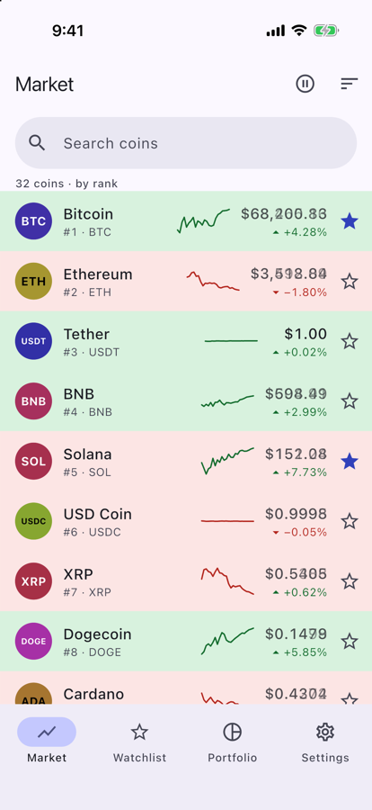 | 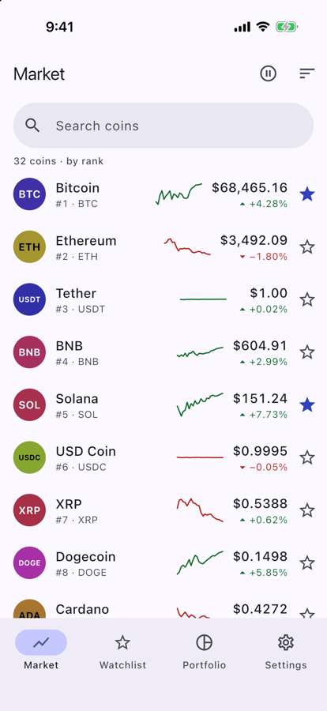 |

---

## Light

| Market | A coin | Watchlist |
|:-:|:-:|:-:|
|  | 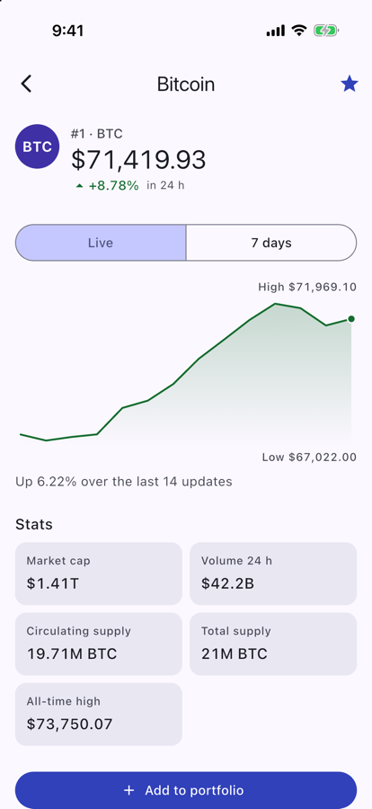 | 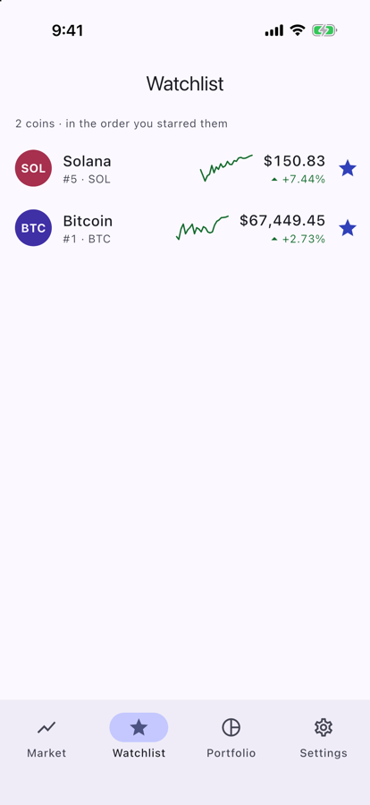 |

| Portfolio | Holding form | Settings |
|:-:|:-:|:-:|
| 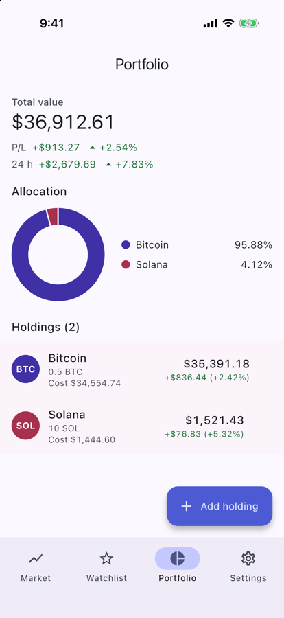 | 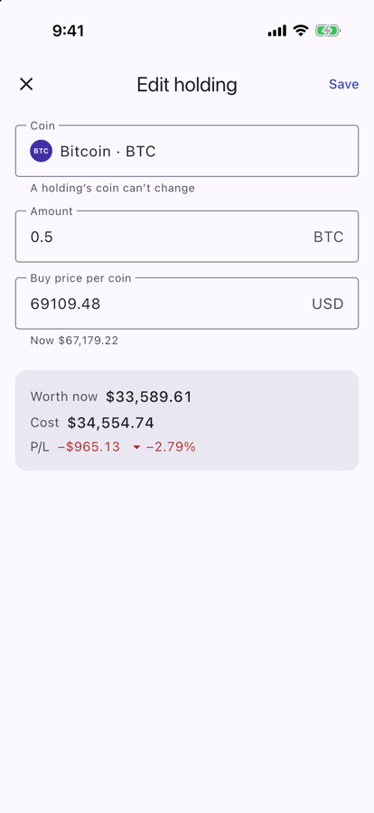 | 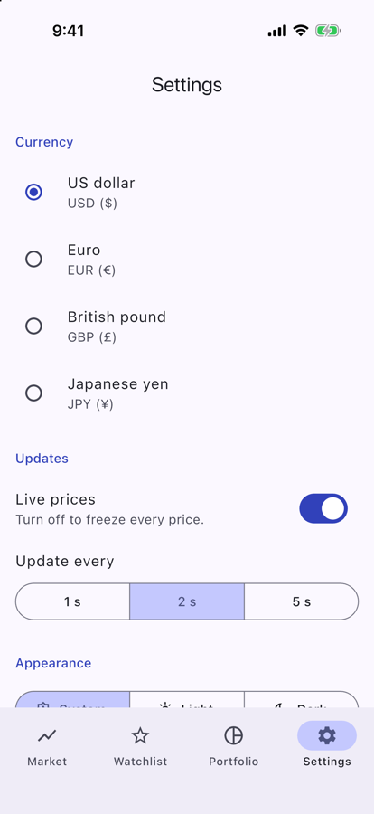 |

---

## Dark

| Market (mid-flash) | A coin | Portfolio |
|:-:|:-:|:-:|
| 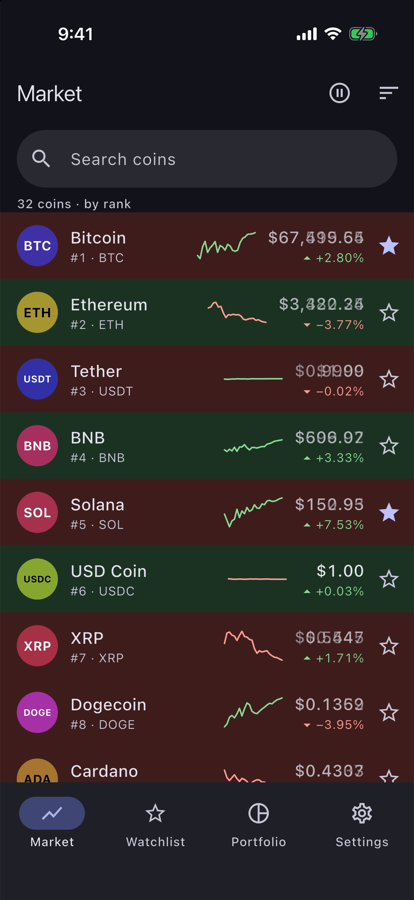 | 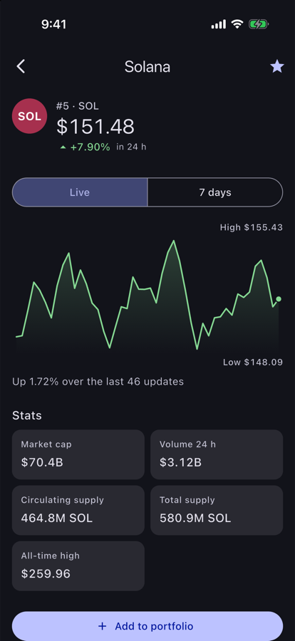 | 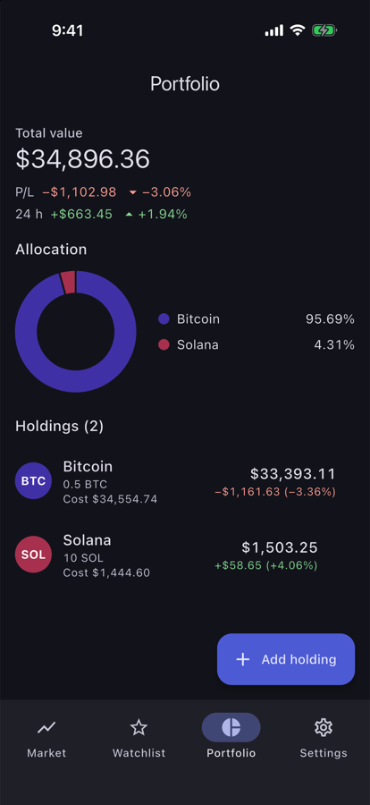 |

---

## Large text (iOS AX3, dark)

Above 130 % text, side-by-side layouts stack: each row puts its price under the name, the totals wrap, the donut sits above its legend.

| Market | Portfolio |
|:-:|:-:|
| 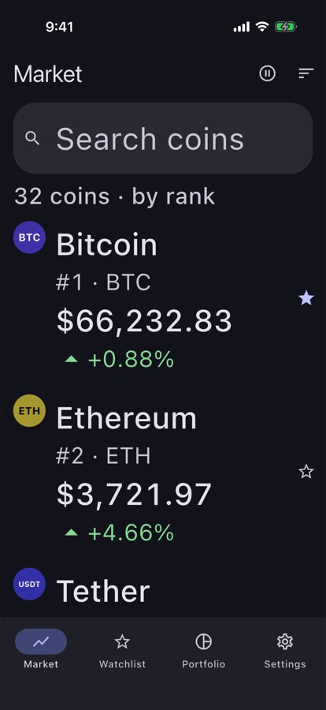 | 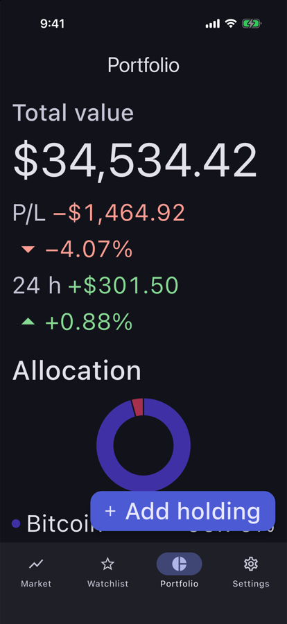 |

---

## Android (release build)

| Market |
|:-:|
| 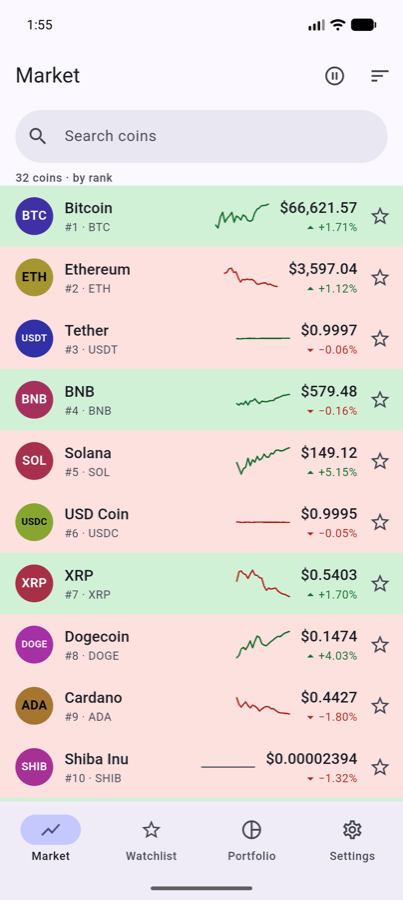 |

The release APK was installed with its data cleared and launched cold. The market loaded and ticked. It asks for no network permission (a test checks the manifest).
